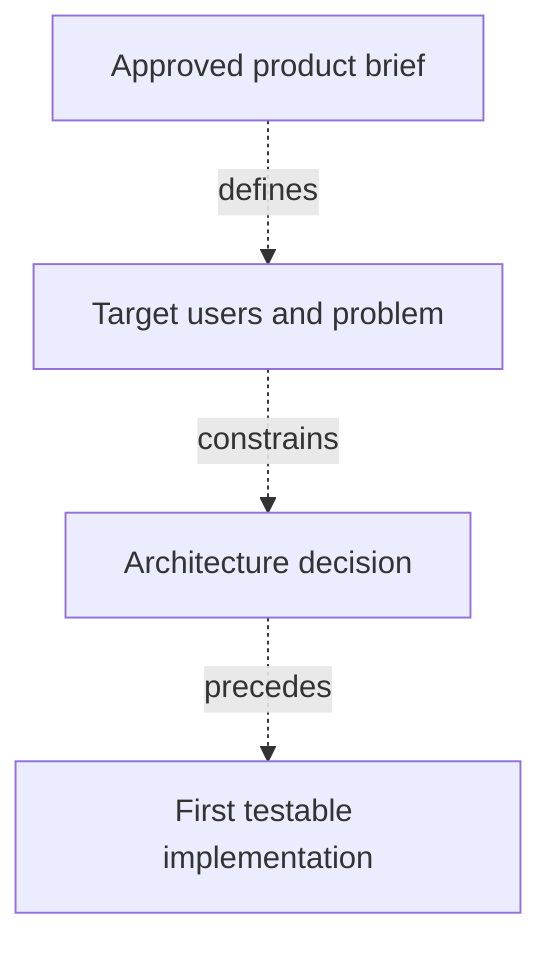

# ZUBAIR APEX

[](#proof-of-concept--enterprise-customization-readiness)

**ZUBAIR APEX is currently an unscoped repository placeholder.** The reviewed default-branch tree contains only this README. No product brief, source code, dependencies, tests, current workflow definitions, or deployment configuration were present.

## 1. Project Overview & Problem Statement

The repository name suggests a possible APEX-branded project, but no verified purpose, target users, business problem, or intended outcome is documented. This README avoids inventing a product or technical capability from the name alone.

A future project brief should define the product scope, user problem, expected result, and maturity target before implementation begins.

## 2. Tech Stack & Versions

No programming language, framework, runtime, model, database, or supported version is declared.

## 3. Prerequisites & Dependencies

No development or runtime dependencies are defined.

## 4. Installation & Local Setup

Clone the repository:

```bash
git clone https://github.com/zopair/-ZUBAIR-APEX-.git
cd -ZUBAIR-APEX-
```

There is no application to install or run.

## 5. Environment Variables

No environment variables, secrets, credentials, or runtime settings are defined.

## 6. Usage Guide & Core Features

No executable features or workflows are implemented in the current default-branch tree.

## 7. Live Demo & Screenshots

No application, API, website, or live demo is deployed.

## 8. Testing & Verification

No source code, tests, current CI workflow files, or deployment checks are present in the reviewed default-branch tree.

Historical CI runs exist in Actions history, but the workflow definitions are not present in the current tree and cannot be reproduced from this source snapshot.

## Proof of Concept & Enterprise Customization Readiness

**Status: Repository placeholder — not yet a PoC or MVP.**

| Area | Current state |
|---|---|
| Product brief | Not defined |
| Architecture | Not defined |
| Source code | None |
| Dependencies | None |
| Environment configuration | None |
| Tests / CI | No current workflow or test files |
| Deployment | Not configured |
| Project license | No root `LICENSE` file present |

The next engineering gate is an approved product brief and a minimal, testable architecture.

## Intellectual Property & Authorship

Requested repository attribution: **Aly Hussein Zopair (علي حسين زبير ALY HUSSEIN ZOPAIR)**.

This attribution does not create a software license or establish rights over third-party components that may be added later.

## Conceptual Architecture

No architecture has been approved or implemented. The following diagram marks the required discovery boundary only:



## Change log

- 2026-11-28 — Added an explicit conceptual discovery flow and documentation baseline. No application code or product scope was invented.
